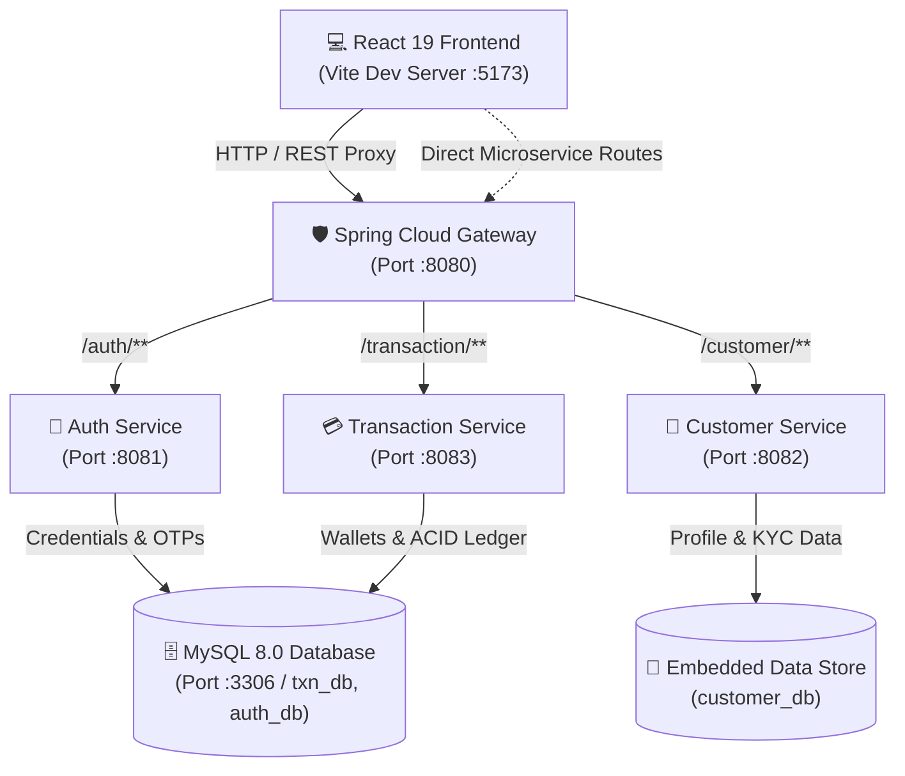

# 🌿 ApnaPay - Next-Gen Fintech & Digital Wallet Platform

[](https://spring.io/projects/spring-boot)
[](https://react.dev/)
[](https://vitejs.dev/)
[](https://tailwindcss.com/)
[](https://www.mysql.com/)
[](https://openjdk.org/)
[](LICENSE)

> **ApnaPay** is a full-stack, enterprise-grade digital wallet, UPI simulation, and banking ledger platform powered by a **Spring Boot microservices architecture**, **MySQL persistence**, and a **React 19 single-page application** styled in an organic **Earthy Tones design system**.

---

## 🏗️ System Architecture

ApnaPay follows an event-ready microservices architecture with a unified API Gateway orchestrating traffic to domain microservices:



---

## 🎨 Earthy Tones Design System

ApnaPay features a warm, organic color palette engineered for readability and financial calm:

| Color Name | Hex Code | Purpose & Usage in ApnaPay |
| :--- | :---: | :--- |
| **Cream** | `#F0EAD2` | App background, subtle card containers, search input bars |
| **Soft Celadon** | `#DDE5B6` | Secondary action highlights, safe badges, QR scan containers |
| **Moss Green** | `#ADC178` | Primary CTA buttons, Send Money flow, success confirmation states |
| **Warm Clay** | `#A98467` | Bank transfers, loyalty tokens, accent tags, financial growth |
| **Deep Espresso** | `#6C584C` | Top navigation headers, brand typography, soundbox alerts |
| **Dark Theme** | `#241D17` / `#2B221B` | Deep Espresso Dark Mode with dynamic font scaling (`sm`, `md`, `lg`, `xl`) |

---

## 🚀 50 Integrated Advanced Features

ApnaPay ships with 50 modular fintech features organized into **8 specialized Innovation Suites**:

### 1. 🤖 AI & Financial Intelligence Suite
- **Smart Payment Intent Engine**: Natural language payment parser (e.g., *"Pay ₹750 to Rahul for pizza"*).
- **Voice-Based Payment Assistant**: Voice waveform visualizer and speech-to-text payment execution.
- **Automatic Expense Categorization**: ML auto-tagger for Dining, Groceries, Utilities, and Lifestyle.
- **Smart Spending Guard**: Daily spending caps, single-transaction ceiling, and midnight lock (1 AM – 5 AM).
- **Dynamic Spending Limits**: Real-time slider controls for UPI daily limits.
- **AI Expense Insights & Budget Recommendations**: 50-30-20 budget breakdown rules and savings advice.

### 2. 👥 Social Finance & Collaborative Savings
- **Group Wallet & Split Settlement**: Shared group pools (e.g., Roommates, Trips) with bill splits and 1-tap settlement.
- **Collaborative / Shared Savings Goals**: Multi-user pooled targets with visual contributor milestones.
- **Financial Goal Tracker**: Personal piggy-banks with **Spare-Change Auto-Roundups**.

### 3. 🛡️ Security, Privacy & Fraud Radar
- **Smart Fraud Detection & Risk Scoring**: 0–100 real-time Risk Radar with explainable AI factors.
- **QR Trust Preview**: Pre-scan merchant safety score, NPCI registry check, and scam reports.
- **Privacy Control Center**: UPI ID phone number masking (`simran.priv@apnapay`) and Incognito balance blurring.
- **Device & Session Management**: Active sessions list with remote termination.
- **Login Activity & Security Alerts**: IP and geolocation sign-in timeline.
- **Secure Account Recovery**: 12-word cryptographic seed phrase and emergency recovery contacts.

### 4. ⚡ Payment Reliability & Multi-Wallet
- **Duplicate Payment Detection**: 5-minute duplicate buffer alert against accidental double debits.
- **Failed Payment Recovery & Retry System**: Multi-rail bank fallback and exponential backoff retry.
- **Transaction Journey Explorer**: 4-node visual tracer (`App` ➔ `NPCI Switch` ➔ `Remitter CBS` ➔ `Payee Bank`).
- **Offline Transaction Drafts**: Local encrypted offline draft queue that auto-broadcasts when online.
- **Multi-Wallet Management**: Primary, Transit, Food Card, and Vault pockets with instant rebalancing.

### 5. ⚖️ Disputes, Refunds & Reminders
- **Payment Dispute & Complaint Management**: Formal NPCI UDIR dispute tickets (`CRN-XXXXXX`) with 48h SLA timer.
- **Refund Tracking System**: 4-stage pipeline stepper (Merchant ➔ NPCI ➔ Bank ➔ Credited).
- **Smart Bill Reminders**: Electricity, Broadband, and Gas bill due-date countdowns with 1-tap Auto-Pay.

### 6. 🏪 Merchant & Growth Suite
- **Merchant Dashboard & Soundbox**: Daily GMV analytics and multilingual voice alerts (*"ApnaPay par ₹500 prapt hue!"*).
- **Loyalty Points & Rewards Engine**: ApnaCoins balance, brand vouchers, and mystery scratch cards.
- **Referral & Cashback System**: Referral link generator and Lucky Cashback Wheel.
- **Multi-Currency Conversion Simulator**: Real-time Forex rates (USD, EUR, GBP, AED, SGD, JPY) with 0 markup.
- **Subscription Detective**: Auto-scans subscriptions (Netflix, Spotify, Gym) with pause/cancel guides.

### 7. 💻 Developer Platform & API Sandbox
- **Payment Sandbox & Failure Simulator**: Simulate HTTP 200, 400, 503, and 504 network error codes.
- **Developer API Playground**: Interactive HTTP request runner with formatted JSON responses.
- **Webhook Event Monitoring & Replay Lab**: Live webhook dispatch log with HMAC SHA256 signatures.
- **Idempotency Protection**: `X-Idempotency-Key` verification against double charges.
- **Transaction Reconciliation Engine**: 3-way reconciliation audit matrix.
- **Real-Time System Health Dashboard**: Latency and uptime monitoring across ports 8080–8083.
- **Automated API Testing Dashboard**: 1-click microservices health ping test suite.

### 8. ⚙️ Admin Governance, Themes & Accessibility
- **Role-Based Admin Panel**: Super Admin, Compliance & AML Officer, and Support Agent views.
- **Audit Logs & Activity Timeline**: Immutable, timestamped system logs.
- **Multilingual Interface**: English, हिन्दी (Hindi), Hinglish, मराठी (Marathi), தமிழ் (Tamil), বাংলা (Bengali).
- **Accessibility Font Scaling**: `sm`, `md`, `lg`, `xl` font scaling.
- **Dark/Light Theme Customization**: Warm Cream Light & Deep Espresso Dark theme toggle.
- **In-App Support Chat**: 24/7 instant support chat with ticket creation.
- **Advanced Transaction Search**: Filter by min/max amount, date range, and debit/credit status.
- **Demo Mode**: 1-click toggle between live MySQL backend and simulated demo sandbox.

---

## 🔐 Security & ACID Guarantees

1. **ACID Atomic Transactions (`@Transactional`)**:
   `sendMoney` and `topUp` execute within a single atomic database transaction with **Pessimistic Row Locking** (`SELECT ... FOR UPDATE`). If any step fails, the entire transaction rolls back automatically.
2. **Idempotency Engine (`X-Idempotency-Key`)**:
   Prevents double debits during network retries or accidental double clicks by caching and validating unique idempotency keys in MySQL.
3. **Password & MPIN Encryption**:
   BCrypt hashing (`cost: 10`) ensures no plaintext passwords or MPINs are ever stored.
4. **JWT Bearer Authentication**:
   Stateless HS256 tokens with 24-hour expiration (`expiresIn: 86400s`).

---

## 🛠️ Tech Stack

- **Backend**: Java 17+, Spring Boot 3.x, Spring Cloud Gateway, Spring Data JPA, Spring Security (BCrypt), JWT
- **Frontend**: React 19, Vite 8, Tailwind CSS, Lucide React Icons
- **Database**: MySQL 8.0 (`txn_db`, `auth_db`), H2 (`customer_db`)
- **Tools**: Maven Wrapper (`mvnw`), PowerShell, Git

---

## ⚡ Quick Start & Run Instructions

### Prerequisites
- Java 17+ installed and configured in `PATH`
- Node.js 18+ and npm installed
- MySQL 8.0 Server running on port `3306` (with databases `txn_db` and `auth_db`)

### 1. One-Click Launch (Windows)
Double-click or run from terminal:
```powershell
.\start-all.bat
```
*This frees ports 8080, 8081, 8082, 8083, 5173, starts all 4 Spring Boot microservices in titled command windows, and launches the Vite React frontend dev server.*

### 2. Manual Startup

#### Step 1: Start Backend Services
```bash
# Terminal 1: Auth Service (Port 8081)
cd auth-service && ./mvnw spring-boot:run

# Terminal 2: Customer Service (Port 8082)
cd customer-service && ./mvnw spring-boot:run

# Terminal 3: Transaction Service (Port 8083)
cd transaction-service && ./mvnw spring-boot:run

# Terminal 4: API Gateway (Port 8080)
cd api-gateway && ./mvnw spring-boot:run
```

#### Step 2: Start Frontend UI
```bash
cd frontend
npm install
npm run dev
```

#### Step 3: Open in Browser
Open **`http://localhost:5173`** to access the live ApnaPay application.

---

## 📡 API Endpoints Reference

| Service | Port | Method | Endpoint | Description |
| :--- | :---: | :---: | :--- | :--- |
| **API Gateway** | `8080` | `*` | `/**` | Reverse proxy and route forwarding |
| **Auth Service** | `8081` | `POST` | `/auth/otp/send` | Send 6-digit OTP |
| **Auth Service** | `8081` | `POST` | `/auth/otp/verify` | Verify OTP and issue JWT |
| **Auth Service** | `8081` | `POST` | `/auth/mpin/set` | Set BCrypt-hashed 4-digit MPIN |
| **Auth Service** | `8081` | `POST` | `/auth/login` | Authenticate with mobile & MPIN |
| **Customer Service** | `8082` | `GET` | `/customer/profile` | Fetch customer KYC profile |
| **Customer Service** | `8082` | `POST` | `/customer/register` | Register new customer |
| **Transaction Service** | `8083` | `GET` | `/transaction/balance` | Query live MySQL wallet balance |
| **Transaction Service** | `8083` | `POST` | `/transaction/wallet/topup` | Credit wallet from bank source |
| **Transaction Service** | `8083` | `POST` | `/transaction/send` | Atomic debit and credit transfer |
| **Transaction Service** | `8083` | `GET` | `/transaction/history` | Query complete ledger statements |

---

## 📄 License

This project is licensed under the MIT License. See [LICENSE](LICENSE) for details.
